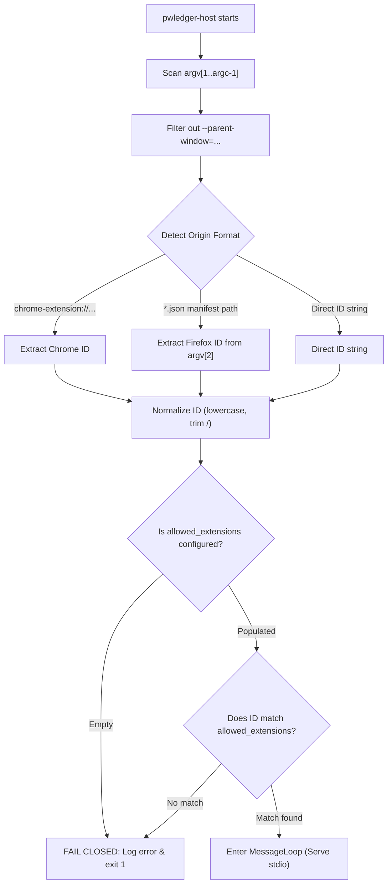

# PWLedger Refactoring Specification (SPEC.md)

**Initiative**: PWLedger Architecture Modernization, Hardening & Security Refactor  
**Status**: DRAFT / PENDING REVIEW (Phase 2)  
**Standard**: ISO C++20, libsodium 1.0.18+, CMake 3.20+  
**Target Platforms**: Linux (x86_64, aarch64), macOS (Apple Silicon, Intel), Windows (MSVC 2022, MinGW-w64)

---

## 1. Objective & Scope

### 1.1 Objective
Transform `pwledger` from a prototype with critical memory safety gaps, undefined behavior, and bypassed security flags into a production-grade, hardened, offline-first password vault.

### 1.2 Core Invariants
1. **Zero Secret Leakage**: No plaintext secret, master password, or decrypted vault stream shall ever reside in unhardened, pageable, or unzeroed heap memory.
2. **100% Wire Format Compatibility**: Existing V1 binary vault files (`PWL\0`, version `1`) must decrypt and load seamlessly. No format version bump.
3. **Native Messaging Protocol Invariance**: The JSON schema exchanged between `pwledger-host` and the Chrome/Firefox browser extension must remain backward-compatible with all existing extension commands (`ping`, `unlock`, `lock`, `init_vault`, `search`, `copy`, `clip_clear`, `get_credentials`).
4. **Platform Parity**: Full compiler warning and security hardening parity across MSVC, GCC, and Clang.
5. **Fail-Closed Security**: Unconfigured or mismatched browser extensions must be rejected at startup.

---

## 2. Target Architecture & Directory Layout

### 2.1 Component Boundaries

```
pwledger/
├── CMakeLists.txt                    # Top-level build config; compiler flags interface
├── cmake/
│   ├── FindSodium.cmake             # Libsodium package finder
│   ├── PwledgerHardening.cmake      # Modern INTERFACE target: pwledger_hardening_flags
│   └── toolchains/
│       └── mingw-w64-x86_64.cmake   # MinGW cross-compilation toolchain definition
├── include/pwledger/                 # Public C++20 headers
│   ├── Common.h                     # Core typedefs, result types, assertion macros
│   ├── Secret.h                     # RAII hardened memory container for credentials
│   ├── SecureBuffer.h               # Hardened dynamic buffer for serialization & crypto
│   ├── SecretEntry.h                # In-memory entry aggregate with explicit payload lengths
│   ├── PrimaryTable.h               # In-memory vault table (std::unordered_map<Uuid, SecretEntry>)
│   ├── EntryMetadata.h              # Timestamps (created, modified, used)
│   ├── EntrySecurityPolicy.h        # Policy metadata (score, 2FA, expiry, notes)
│   ├── VaultCrypto.h                # Argon2id KDF + XChaCha20-Poly1305 AEAD engine
│   ├── VaultSerializer.h            # V1 binary wire serializer / deserializer with bound checks
│   ├── VaultIO.h                    # Atomic file load/save (MoveFileExW / POSIX fsync + umask)
│   ├── VaultPath.h                  # Cross-platform config & vault path resolution
│   ├── Config.h                     # JSON configuration model (nlohmann::json)
│   ├── ProcessHardening.h           # Anti-debugging, core dump disablement, heap flags
│   ├── TerminalManager.h            # Direct RAII terminal echo/canonical mode controller
│   ├── Clipboard.h                  # OS clipboard read/write/clear (Windows CF_UNICODETEXT / POSIX)
│   ├── ClipboardTimer.h             # Thread-safe auto-clear timer with lock synchronization
│   └── uuid.h                       # 128-bit UUID v4 with libsodium CSPRNG & safe hash
├── src/                             # pwledger_core STATIC library implementation
│   ├── CMakeLists.txt
│   ├── Common.cc
│   ├── Secret.cc
│   ├── SecureBuffer.cc
│   ├── SecretEntry.cc
│   ├── uuid.cc
│   ├── VaultCrypto.cc
│   ├── VaultSerializer.cc
│   ├── VaultIO.cc
│   ├── VaultPath.cc
│   ├── Config.cc
│   ├── ProcessHardening.cc
│   ├── TerminalManager.cc
│   └── Clipboard.cc
├── apps/
│   ├── CMakeLists.txt
│   ├── cli/                         # pwledger CLI executable
│   │   ├── AppState.h
│   │   ├── CommandLoop.h / .cc
│   │   ├── Display.h / .cc
│   │   ├── EntryOps.h / .cc
│   │   ├── SecretIO.h / .cc         # Stdin password reading with backspace handling
│   │   └── main.cc
│   └── native_host/                 # pwledger-host stdio executable
│       ├── NativeMessaging.h / .cc  # Framing protocol (4-byte LE length + JSON)
│       ├── CommandHandlers.h / .cc  # Command dispatch with minimal secret lifetime
│       ├── MessageLoop.h / .cc      # Stdio loop with clean exception boundaries
│       └── main.cc                  # Argv origin check + fail-closed startup
├── extension/                       # WebExtension (MV2)
│   ├── manifest.json                # "all_frames": false, minimum permissions
│   ├── background.js                # sender.tab.url validation, gesture enforcement
│   ├── content.js                   # In-field badge, user-gesture trigger only
│   └── popup/                       # User-initiated credential search and copy
├── setup/                           # Automated installation & native manifest registration
│   ├── setup.sh                     # Linux/macOS installer (populates allowed_extensions)
│   └── setup.ps1                    # Windows installer (populates allowed_extensions)
└── tests/                           # GoogleTest test suite
    ├── CMakeLists.txt
    ├── fixtures/                    # Compatibility fixtures (V1 binary vault assets)
    ├── test_secret.cc
    ├── test_secure_buffer.cc
    ├── test_uuid.cc
    ├── test_serializer.cc
    ├── test_vault_crypto.cc
    ├── test_vault_io.cc
    ├── test_config.cc
    └── test_native_messaging.cc
```

---

## 3. Secret Ownership & Hardened Memory Model

### 3.1 Hardened Memory Guarantees
All secret material (master passwords, derived encryption keys, per-entry passwords, decrypted serialization streams) must satisfy:
1. **Hardware Page Locking**: Allocated with `sodium_malloc()`, locking pages into RAM (`mlock` on POSIX, `VirtualLock` on Windows) to prevent swapping to disk.
2. **Canaries & Guard Pages**: Enclosed by `PROT_NONE` (`PAGE_NOACCESS`) guard pages immediately before and after the allocated pages to trigger immediate hardware trap on out-of-bounds reads or writes.
3. **No-Access Default**: Plaintext secret pages must remain `PROT_NONE` when idle. Access is granted transiently via RAII scoped guards (`sodium_mprotect_readonly()` or `sodium_mprotect_readwrite()`) and reverted to `sodium_mprotect_noaccess()` upon guard destruction.
4. **Deterministic Erasure**: Before deallocation, all memory is wiped with `sodium_memzero()` to defeat compiler dead-store elimination.
5. **No Core Dump / Pagefile Residuals**: Memory dumps disabled at the OS level via `harden_process()`.

### 3.2 Permitted Plaintext Types

| Type | Purpose | Memory Backing | Access Method |
|---|---|---|---|
| `pwledger::Secret` | Single credential (password, token) | `sodium_malloc` (page-locked, guard pages) | Scoped access guard: `with_read_access()`, `with_write_access()` |
| `pwledger::SecureBuffer` | Variable-length byte stream (vault serialization, KDF input/output) | `sodium_malloc` (page-locked, realloc-safe) | `span<uint8_t>`, `span<const uint8_t>`, `data()`, `size()` |

**PROHIBITED FOR SECRETS**:
- `std::string`
- `std::vector<uint8_t>` / `std::vector<char>`
- Plain heap `new[]` or `malloc()`
- Unzeroed stack buffers without RAII wiping
- `nlohmann::json` values holding decrypted passwords

### 3.3 Ownership Hierarchy

```
PrimaryTable (in-memory)
    └── SecretEntry
            ├── Uuid (raw 16 bytes)
            ├── string title, username, url (metadata - standard heap allowed)
            ├── EntryMetadata (timestamps)
            ├── EntrySecurityPolicy
            └── Secret plaintext_secret (HARDENED MEMORY)
                    ├── void* memory_ (sodium_malloc)
                    ├── size_t capacity_ (page multiple)
                    └── size_t payload_len_ (exact secret bytes)
```

---

## 4. `SecureBuffer` Design (Task 1.4)

### 4.1 Specification
`SecureBuffer` replaces standard `std::vector<uint8_t>` in `VaultSerializer`, `VaultCrypto`, and `VaultIO`.

```cpp
namespace pwledger {

class SecureBuffer {
public:
    SecureBuffer() noexcept;
    explicit SecureBuffer(std::size_t initial_capacity);
    ~SecureBuffer();

    // Move-only (no shallow copying of secret memory)
    SecureBuffer(SecureBuffer&& other) noexcept;
    SecureBuffer& operator=(SecureBuffer&& other) noexcept;
    SecureBuffer(const SecureBuffer&) = delete;
    SecureBuffer& operator=(const SecureBuffer&) = delete;

    // Buffer operations
    void resize(std::size_t new_size);
    void reserve(std::size_t new_capacity);
    void append(std::span<const std::uint8_t> data);
    void append(std::uint8_t byte);
    void clear() noexcept;

    // Accessors
    [[nodiscard]] std::uint8_t* data() noexcept { return data_; }
    [[nodiscard]] const std::uint8_t* data() const noexcept { return data_; }
    [[nodiscard]] std::size_t size() const noexcept { return size_; }
    [[nodiscard]] std::size_t capacity() const noexcept { return capacity_; }
    [[nodiscard]] bool empty() const noexcept { return size_ == 0; }
    [[nodiscard]] std::span<std::uint8_t> as_span() noexcept;
    [[nodiscard]] std::span<const std::uint8_t> as_span() const noexcept;

    // Zeroes all buffer contents without deallocating
    void zeroize() noexcept;

private:
    std::uint8_t* data_{nullptr};
    std::size_t size_{0};
    std::size_t capacity_{0};

    void reallocate(std::size_t new_capacity);
};

} // namespace pwledger
```

### 4.2 Reallocation & Zeroing Invariants
- When `reserve()` or `append()` exceeds current capacity, a new buffer is allocated via `sodium_malloc(new_capacity)`.
- Existing active bytes (`size_`) are copied to the new buffer.
- The old buffer is erased using `sodium_memzero(old_data, old_capacity)` before invoking `sodium_free(old_data)`. No intermediate copies are left in unmanaged memory.
- If `sodium_malloc()` fails, `std::abort()` is called immediately to prevent falling back to unhardened memory.
- Destructor invokes `zeroize()` and `sodium_free()`.

---

## 5. `Secret` Payload Length & V1 Compatibility Model (Task 1.2)

### 5.1 The Root Problem in Original Code
Original `SecretEntry` held `Secret plaintext_secret` with a fixed allocation capacity (e.g., 64 bytes). It did not record how many bytes of that buffer were valid data. Consequently, `VaultSerializer::serialize()` used `::strnlen(buf.data(), buf.size())` to determine the length. This resulted in:
1. Binary secrets containing `0x00` were truncated at the first null byte.
2. Secrets without a trailing null byte read uninitialized canary bytes (`0xdb`) up to buffer capacity.

### 5.2 The Solution
`Secret` encapsulates both allocated `capacity_` and active `payload_len_`:

```cpp
class Secret {
public:
    static Secret allocate(std::size_t capacity);
    
    // Set secret data from a span of bytes; sets payload_len_ = data.size()
    void set(std::span<const char> data);
    void set(std::span<const std::uint8_t> data);

    [[nodiscard]] std::size_t payload_length() const noexcept { return payload_len_; }
    [[nodiscard]] std::size_t capacity() const noexcept { return capacity_; }

    // Access methods now provide spans bounded by payload_len_, NOT full capacity!
    template <typename F>
    void with_read_access(F&& func) const;

    template <typename F>
    void with_write_access(F&& func);
};
```

### 5.3 V1 Format Byte Compatibility
The V1 binary format encodes each entry as:
```
[UUID: 16B][title_len: 4B][title][user_len: 4B][user][url_len: 4B][url]
[secret_len: 4B][secret_bytes: secret_len B]
[created: 8B][modified: 8B][used: 8B]
[security_score: 4B][requires_2fa: 1B][expires_at: 8B][notes_len: 4B][notes]
```
Because the wire format **already** stores `secret_len` as a 32-bit unsigned integer, writing `payload_len_` instead of `strnlen()` generates valid V1 payloads that existing and refactored deserializers consume without format changes.

### 5.4 Legacy Vault Limitation (Documented)
Vaults serialized with the original code containing passwords with embedded `0x00` were already truncated at save time. The truncated bytes were never written to disk. The refactored code will deserialize those truncated records as saved, without error.

---

## 6. Native Host Extension Origin Validation (Task 4.1)

### 6.1 Multi-Browser Command-Line Discrepancies
When launching Native Messaging hosts, browsers pass command-line arguments according to differing platform specifications:

1. **Google Chrome / Chromium**:
   - `argv[1]` = `chrome-extension://<extension_id>/`
   - On **Windows**, Chrome also passes `--parent-window=<HWND>` as an additional command-line parameter. This flag must not be mistaken for the extension origin.
2. **Mozilla Firefox**:
   - `argv[1]` = Absolute file path to the native messaging manifest (`/path/to/pwledger.json`).
   - `argv[2]` = Extension ID (the WebExtension ID defined in `manifest.json`, e.g., `pwledger@example.com` or UUID).

### 6.2 Host Validation Pipeline
The host `main(int argc, char* argv[])` executes the following algorithm before accepting any messages:



### 6.3 Fail-Closed Policy
If `IntegrationConfig::allowed_extensions` is empty or does not contain the detected extension ID:
1. Log a clear, structured diagnostic to `std::cerr`:
   ```
   [ERROR] [pwledger-host] Extension authentication failed.
   Detected extension origin: 'chrome-extension://hknf.../'
   Allowed extensions: []
   Access denied: allowed_extensions is empty or does not match.
   Configure allowed_extensions in pwledger.json or re-run setup.ps1/setup.sh.
   ```
2. Immediately terminate with exit code `1` without reading `stdin`.

### 6.4 Security Boundary Clarification
Command-line arguments can be spoofed by any local process running under the user's desktop session. Native messaging origin validation is **defense in depth** to prevent unauthorized browser extensions or accidental misuse, but is not an impenetrable OS-level sandbox boundary against malicious local code.

---

## 7. Native Host Secret Lifetime & JSON Sanitization (Task 4.2)

### 7.1 Threat Model
In `pwledger-host`, JSON parsing via `nlohmann::json` constructs dynamically-allocated `std::string` nodes on the CRT heap. When `handle_unlock` parses the master password or `handle_get_credentials` serializes passwords, unzeroed heap memory remains in the host process.

### 7.2 Mitigation Strategy
1. **Inbound Master Password (`unlock`)**:
   - `handle_unlock` extracts the `"password"` field directly into a `Secret` object using a custom helper `extract_secret(json, "password")`.
   - The string temporary in `json` is overwritten with zeros using `volatile` writes or `sodium_memzero(s.data(), s.size())` immediately after transfer, before the JSON object is destroyed.
2. **Outbound Credentials (`get_credentials`)**:
   - The JSON response payload is built directly into a `SecureBuffer` or serialized into a string that is immediately wiped with `sodium_memzero` after being written to `stdout`.
3. **Residual Risk Statement**:
   - Complete elimination of all temporary string allocations within `nlohmann::json` internals would require replacing the entire JSON parser with a custom zero-allocation parser. Given that `pwledger-host` runs in an isolated process with core dumps disabled and locked memory, zeroing the string nodes immediately after use reduces secret persistence to milliseconds and eliminates persistent heap residue.

---

## 8. Browser Extension Auto-Fill & Security Policy (Task 4.4)

### 8.1 Auto-Fill Security Invariants
- **No Passive Auto-Fill**: By default, credentials are never requested or injected automatically on page load.
- **Explicit User Gesture**: Auto-fill occurs only when the user explicitly:
  1. Clicks an entry in the browser extension popup, or
  2. Clicks an interactive in-field shield icon rendered inside the username/password input.
- **Opt-In Auto-Fill On Load**:
  - Controlled by configuration setting: `integration.autofill_on_load: false`.
  - Even if enabled, auto-fill only triggers if the page origin matches exactly one vault entry.
- **Top-Frame Isolation**:
  - `manifest.json` sets `"all_frames": false` for content scripts.
  - `background.js` verifies `sender.frameId === 0` on every message. Messages from nested frames/iframes are dropped immediately.
- **Origin Validation**:
  - `background.js` extracts the target origin strictly from `sender.tab.url` provided by the browser engine.
  - The URL submitted by the content script in `message.url` is untrusted and ignored for credential lookup.
  - Domain matching uses exact origin (`scheme + host + port`, e.g., `https://example.com:443` or `https://example.com`), rejecting substring or prefix matches. No Public Suffix List (PSL) is used to avoid external dependencies. Subdomain matching is out of scope and reserved as a future option.

---

## 9. Error-Handling Policy & Process Termination Hierarchy

| Scenario | Severity | Action | Mechanism |
|---|---|---|---|
| `sodium_malloc()` failure | Catastrophic | Terminate immediately | `std::abort()` (Never fall back to unhardened heap) |
| Heap memory guard violation | Catastrophic | Hardware trap | OS signal / `SIGSEGV` via page protection |
| Corrupt vault header / HMAC failure | Recoverable Error | Throw typed domain exception | `VaultCorruptException` |
| Invalid master password | Recoverable Error | Throw authentication exception | `AuthenticationFailedException` |
| Vault filesystem / IO error | Recoverable Error | Throw typed IO exception | `VaultIoException` |
| Terminal backspace / input error | Recoverable Error | Redraw / handle in loop | In-place character buffer mutation |
| Malformed Native Messaging JSON | Host Error | Send structured error JSON | `write_message(json{{"error", "Malformed request"}})` |
| Native Messaging EOF | Expected Termination | Exit host cleanly | `exit(0)` |

---

## 10. Boundaries & Rules

### ALWAYS
- Allocate secrets and serialization payloads in `sodium_malloc` locked memory (`Secret` and `SecureBuffer`).
- Wipe buffers using `sodium_memzero()` before freeing.
- Enforce compiler warnings-as-errors (`-Werror`, `/WX`) across all build presets.
- Use `std::memcpy` for unaligned integer loading.
- Verify return codes on all filesystem and cryptographic operations.

### ASK FIRST
- Adding any new external third-party library or CMake dependency.
- Modifying Argon2id parameters (ops limit, mem limit) or AEAD algorithms.
- Altering CLI command syntax or flags.
- Changing the Native Messaging JSON protocol schema.

### NEVER
- Store plaintext secrets in `std::string` or `std::vector<uint8_t>`.
- Log secrets, keys, or passwords to stdout or stderr.
- Silence compiler warnings using `#pragma warning(disable)`, `#pragma GCC diagnostic ignored`, or `// NOLINT`.
- Delete, comment out, or skip existing tests to achieve a passing build.
- Weaken compiler or linker hardening flags (`/GS`, `/guard:cf`, `-fstack-protector-strong`, `-D_FORTIFY_SOURCE=3`).

---

## 11. Non-Goals
1. **Vault V2 Wire Format**: V1 binary compatibility must be maintained. No multi-version format migrations.
2. **Cloud Synchronization / Web Services**: PWLedger is strictly offline-first. No remote API endpoints or sync servers.
3. **Manifest V3 Extension Migration**: The browser extension remains MV2 compliant for this refactor cycle.
4. **GUI Application**: The application interfaces remain terminal CLI and browser extension host.
