# PWLedger Incremental Implementation Plan (TASKS.md)

**Initiative**: PWLedger Hardening & Refactoring Tasks  
**Strategy**: Thin vertical slices (~100 lines each), one atomic commit per task, always buildable, always revertable.  
**Branching**: `refactor/<theme>` branched from `main`.  
**Hard Rules**:
- Keep existing tests green at all times.
- Include a minimal regression test with every Critical/Major fix.
- No new external dependencies without user approval.
- No weakening of compiler warning or hardening flags.
- Zero secrets in standard `std::string` or general heap.
- Line Endings: Files keep the EOL style they have today; new files use LF; do not mix styles within a file. A repo-wide EOL normalization is a separate, explicit commit that only the user may request.

---

## Task Dependency Graph

```mermaid
flowchart TD
    T01["TASK-01: Git Baseline & V1 Compatibility Fixture"] --> T02["TASK-02: CMake Presets Setup"]
    T02 --> T03["TASK-03: UUID Alignment & CSPRNG (COR-01)"]
    T03 --> T04["TASK-04: Secret Payload Length (SEC-01)"]
    T04 --> T05["TASK-05: SecureBuffer Implementation (SEC-02)"]
    T05 --> T06["TASK-06: Deserializer Bounds Validation (COR-03, COR-05)"]
    T06 --> T07["TASK-07: CMake Interface Target pwledger_hardening_flags"]
    T07 --> T08["TASK-08: Activate MSVC Hardening Flags (SEC-06)"]
    T08 --> T09["TASK-09: Automated GitHub Actions CI Pipeline (CI-01)"]
    T09 --> T10["TASK-10: Cross-Platform Atomic File Save (COR-02, SEC-08)"]
    T10 --> T11["TASK-11: TerminalManager CRTP Simplification (ARC-01)"]
    T11 --> T12["TASK-12: Terminal Backspace Password Input (COR-04)"]
    T12 --> T13["TASK-13: Process Hardening on Windows/macOS (SEC-07)"]
    T13 --> T14["TASK-14: Unicode Clipboard & Timer Invalidation (COR-06, SEC-09)"]
    T14 --> T15["TASK-15: Secret-Safe Logging & Error Hierarchy (OBS-01, ARC-03)"]
    T15 --> T16["TASK-16: Fail-Closed Native Host Origin Check (SEC-03)"]
    T16 --> T17["TASK-17: Native Host Secret Wiping & JSON Scrubbing (SEC-05)"]
    T17 --> T18["TASK-18: Native Host Stdio Protocol Robustness (ARC-02)"]
    T18 --> T19["TASK-19: Browser Extension User Gesture Auto-Fill (SEC-04)"]
```

---

## Detailed Task Specifications

### Stage 1: Baseline & Verification Setup

#### TASK-01: Baseline & V1 Compatibility Fixture Setup
- **Goal**: Establish the compatibility fixture test asset generated by the original codebase (`tests/fixtures/v1_original_vault.pwl`) and register a regression test to guarantee byte-level V1 reading compatibility across all subsequent commits.
- **Files Touched**: `tests/fixtures/v1_original_vault.pwl`, `tests/test_vault.cc`, `tests/CMakeLists.txt`
- **Acceptance Criteria**:
  - `ctest --test-regex TestVaultCompatibility -V` passes against the fixture.
- **Dependencies**: None.
- **Risk**: Low.
- **Size**: ~60 lines.
- **Rollback**: `git checkout HEAD~1`
- **Skills**: `/test-driven-development`, `/git-workflow-and-versioning`

---

#### TASK-02: CMake Presets & Multi-Configuration Setup
- **Goal**: Create modern `CMakePresets.json` supporting Windows MSVC (`debug`, `relwithdebinfo`, `asan`), MinGW GCC (`gcc-debug`, `gcc-release`), and Linux/macOS presets.
- **Files Touched**: `CMakePresets.json`
- **Acceptance Criteria**:
  - `cmake --preset default` generates build trees cleanly on MSVC and GCC.
- **Dependencies**: TASK-01.
- **Risk**: Low.
- **Size**: ~80 lines.
- **Rollback**: Remove `CMakePresets.json`.
- **Skills**: `/ci-cd-and-automation`

---

### Stage 2: Core Correctness & Critical Security Hardening

#### TASK-03: Fix Uuid Unaligned Dereference & Replace with Libsodium CSPRNG (COR-01)
- **Goal**: Eliminate undefined behavior in `std::hash<Uuid>` by replacing unaligned `reinterpret_cast<const uint64_t*>` with safe `std::memcpy` into local variables. Replace `std::mt19937_64` in `Uuid::generate()` with `randombytes_buf()` from libsodium. Remove case-collision orphan header file.
- **Files Touched**: `include/pwledger/uuid.h`, `src/uuid.cc`, `tests/test_uuid.cc`
- **Acceptance Criteria**:
  - `ctest --test-regex TestUuid -V` passes with `-DPWLEDGER_ENABLE_SANITIZERS=ON` without UBSan alignment traps.
- **Dependencies**: TASK-01.
- **Risk**: Low.
- **Size**: ~75 lines.
- **Rollback**: Revert commit on `refactor/core-crypto`.
- **Skills**: `/doubt-driven-development`, `/test-driven-development`

---

#### TASK-04: Explicit Secret Payload Length & Elimination of `strnlen` (SEC-01)
- **Goal**: Refactor `Secret` to track explicit `payload_length` alongside allocated capacity. Update `with_read_access()` and `with_write_access()` to pass `std::span` bounded by actual payload length. Update `VaultSerializer::serialize()` to write `payload_length` instead of calling `::strnlen()`. Add regression test verifying secrets with embedded `0x00`.
- **Files Touched**: `include/pwledger/Secret.h`, `src/Secret.cc`, `include/pwledger/SecretEntry.h`, `src/VaultSerializer.cc`, `apps/cli/Display.cc`, `tests/test_secret.cc`
- **Acceptance Criteria**:
  - A secret containing binary `0x00` bytes persists and round-trips through serialize/deserialize without byte loss.
- **Dependencies**: TASK-03.
- **Risk**: High (touches core memory model).
- **Size**: ~110 lines.
- **Rollback**: Revert commit on `refactor/core-crypto`.
- **Skills**: `/doubt-driven-development`, `/test-driven-development`, `/security-and-hardening`

---

#### TASK-05: Secure Serialization & Decryption Buffer (`SecureBuffer`) (SEC-02)
- **Goal**: Implement `SecureBuffer` backed by `sodium_malloc()` with page locking, guard pages, safe reallocation with wiping, and RAII destruction. Replace `std::vector<uint8_t>` in `VaultSerializer::serialize()`, `VaultSerializer::deserialize()`, `VaultCrypto::encrypt_vault()`, and `VaultCrypto::decrypt_vault()`.
- **Files Touched**: `include/pwledger/SecureBuffer.h`, `src/SecureBuffer.cc`, `include/pwledger/VaultSerializer.h`, `src/VaultSerializer.cc`, `include/pwledger/VaultCrypto.h`, `src/VaultCrypto.cc`, `src/VaultIO.cc`, `tests/test_secure_buffer.cc`
- **Acceptance Criteria**:
  - All vault serialize, deserialize, encrypt, and decrypt operations operate exclusively on `SecureBuffer`.
  - Zero heap realloc leaks under ASan/LSan.
- **Dependencies**: TASK-04.
- **Risk**: High (core cryptographic pipeline).
- **Size**: ~125 lines.
- **Rollback**: Revert commit on `refactor/core-crypto`.
- **Skills**: `/doubt-driven-development`, `/security-and-hardening`, `/source-driven-development`

---

#### TASK-06: Strict Bounds Validation in `VaultSerializer::deserialize` (COR-03, COR-05)
- **Goal**: Harden `deserialize` against malformed and malicious vault files. Enforce bounds checks that guarantee any vault readable by the original code remains readable: `kMaxEntries = 10,000` (graceful limit throwing `VaultCorruptException`), `kMaxSecretLen = 1,048,576` (1 MiB), `kMaxNoteLen = 1,048,576` (1 MiB), `kMaxTitleLen = 65,536` (64 KB), `kMaxUsernameLen = 65,536` (64 KB). Prevent integer overflow in position offset checks (`pos > size - len`). Throw `VaultCorruptException` on bounds violation or allocation failure instead of aborting.
- **Files Touched**: `src/VaultSerializer.cc`, `include/pwledger/VaultSerializer.h`, `tests/test_serializer.cc`
- **Acceptance Criteria**:
  - Test case feeding corrupt/fuzzed payloads with huge lengths throws `VaultCorruptException` without crashing or aborting.
- **Dependencies**: TASK-05.
- **Risk**: Medium.
- **Size**: ~90 lines.
- **Rollback**: Revert commit.
- **Skills**: `/security-and-hardening`, `/test-driven-development`

---

### Stage 3: Build System Modernization & CI Pipeline

#### TASK-07: Modern CMake Interface Target `pwledger_hardening_flags` (SEC-06, ARC-04)
- **Goal**: Refactor `cmake/PwledgerCompilerUnix.cmake` and `cmake/PwledgerCompilerMSVC.cmake` into a modern `add_library(pwledger_hardening_flags INTERFACE)` target. Link this target `PUBLIC` to `pwledger_core` and `PRIVATE` to apps. Remove obsolete directory variables (`TOP_DIR`, `PWLEDGER_DIR`).
- **Files Touched**: `CMakeLists.txt`, `cmake/PwledgerHardening.cmake`, `src/CMakeLists.txt`, `apps/CMakeLists.txt`
- **Acceptance Criteria**:
  - `cmake -B build` completes cleanly without warnings or errors on all platforms.
- **Dependencies**: TASK-06.
- **Risk**: Low.
- **Size**: ~95 lines.
- **Rollback**: Revert commit on `refactor/build-hardening`.
- **Skills**: `/ci-cd-and-automation`

---

#### TASK-08: Activate MSVC Binary Hardening Flags (SEC-06)
- **Goal**: Explicitly configure and activate MSVC hardening options (`/GS`, `/sdl`, `/guard:cf`, `/NXCOMPAT`, `/DYNAMICBASE`, `/HIGHENTROPYVA`, `/WX`) on Windows targets.
- **Files Touched**: `cmake/PwledgerHardening.cmake`
- **Acceptance Criteria**:
  - Running `dumpbin /headers bin\pwledger-cli.exe` confirms `Dynamic base`, `NX compatible`, `High Entropy VA`, and `Guard` flags are enabled.
- **Dependencies**: TASK-07.
- **Risk**: Medium (compiler flag compatibility).
- **Size**: ~50 lines.
- **Rollback**: Revert commit.
- **Skills**: `/security-and-hardening`, `/ci-cd-and-automation`

---

#### TASK-09: Automated GitHub Actions CI Pipeline (CI-01)
- **Goal**: Create comprehensive `.github/workflows/ci.yml` running a multi-platform build matrix:
  - Ubuntu (GCC 13, Clang 16 with ASan+UBSan)
  - macOS (Apple Clang)
  - Windows (MSVC 2022 with ASan)
  - Runs all unit tests, executes `clang-tidy`, and verifies binary hardening flags.
- **Files Touched**: `.github/workflows/ci.yml`
- **Acceptance Criteria**:
  - CI workflow triggers and runs cleanly on GitHub.
- **Dependencies**: TASK-08.
- **Risk**: Low.
- **Size**: ~110 lines.
- **Rollback**: Remove `.github/workflows/ci.yml`.
- **Skills**: `/ci-cd-and-automation`

---

### Stage 4: Core Robustness & Simplification

#### TASK-10: Cross-Platform Atomic Vault File Replacement (COR-02, SEC-08)
- **Goal**: Replace non-atomic / Windows-failing `std::filesystem::rename` with platform-specific atomic replacement:
  - POSIX: Generate unique temporary filename in same directory (`.<file>.tmp.XXXXXX`), `open(O_WRONLY | O_CREAT | O_EXCL, 0600)` (eliminating symlink attacks and umask race), write ciphertext, `fsync(fd)`, `close(fd)`, `rename(temp, target)`, and `fsync` the parent directory. On any failure path, unlink temporary file immediately.
  - Windows: Generate unique temporary filename in same directory, write ciphertext, `FlushFileBuffers()`, close handle, `MoveFileExW(temp, target, MOVEFILE_REPLACE_EXISTING | MOVEFILE_WRITE_THROUGH)`. On any failure, delete temporary file with `DeleteFileW()`.
- **Files Touched**: `src/VaultIO.cc`, `include/pwledger/VaultIO.h`, `tests/test_vault_io.cc`
- **Acceptance Criteria**:
  - Saving over an existing vault file succeeds on Windows without `ERROR_ALREADY_EXISTS`.
  - File permissions on Linux/macOS are strictly `0600` at creation time with parent directory fsync.
  - Zero temporary files left behind on failure paths.
- **Dependencies**: TASK-09.
- **Risk**: Medium.
- **Size**: ~105 lines.
- **Rollback**: Revert commit.
- **Skills**: `/debugging-and-error-recovery`, `/security-and-hardening`

---

#### TASK-11: TerminalManager CRTP Simplification (ARC-01)
- **Goal**: Eliminate the over-engineered CRTP template base and `TerminalManagerDerivable` concept. Consolidate `TerminalManager` into a single, concrete RAII class with `#ifdef` platform state (POSIX `termios` / Windows `GetConsoleMode`).
- **Files Touched**: `include/pwledger/TerminalManager.h`, `src/TerminalManager.cc`
- **Acceptance Criteria**:
  - Code reduced by ~120 lines while preserving identical RAII terminal echo suppression behavior.
- **Dependencies**: TASK-10.
- **Risk**: Low.
- **Size**: ~85 lines net reduction.
- **Rollback**: Revert commit.
- **Skills**: `/code-simplification`

---

#### TASK-12: Interactive Terminal Backspace Password Input (COR-04)
- **Goal**: Update `read_secret_from_stdin()` in `SecretIO.cc` to handle backspace (`0x08`) and DEL (`0x7f`) when terminal is in raw/non-canonical mode. Erase characters from buffer and emit terminal erase sequence (`\b \b`) so editing corrections do not corrupt passwords.
- **Files Touched**: `apps/cli/SecretIO.cc`, `apps/cli/SecretIO.h`
- **Acceptance Criteria**:
  - Typing password, pressing backspace, and typing replacement sets exact corrected password into `Secret`.
- **Dependencies**: TASK-11.
- **Risk**: Low.
- **Size**: ~55 lines.
- **Rollback**: Revert commit.
- **Skills**: `/debugging-and-error-recovery`

---

#### TASK-13: Process Hardening on Windows and macOS (SEC-07)
- **Goal**: Implement `harden_process()` for Windows and macOS:
  - Windows: `SetProcessDEPPolicy()`, `SetProcessMitigationPolicy()` (disable dynamic code generation), `SetErrorMode(SEM_NOGPFAULTERRORBOX)`.
  - macOS: `setrlimit(RLIMIT_CORE, 0)` and `ptrace(PT_DENY_ATTACH, 0, 0, 0)`.
- **Files Touched**: `src/ProcessHardening.cc`, `include/pwledger/ProcessHardening.h`
- **Acceptance Criteria**:
  - Calling `harden_process()` on Windows and macOS completes without error and applies OS mitigations.
- **Dependencies**: TASK-12.
- **Risk**: Low.
- **Size**: ~75 lines.
- **Rollback**: Revert commit.
- **Skills**: `/security-and-hardening`

---

#### TASK-14: Windows Unicode Clipboard & Auto-Clear on Lock (COR-06, SEC-09)
- **Goal**: Switch Windows clipboard write in `Clipboard.cc` from `CF_TEXT` to `CF_UNICODETEXT` (converting UTF-8 to UTF-16 with `MultiByteToWideChar`). In `ClipboardTimer`, support thread-safe immediate cancellation and clipboard clearing upon vault lock.
- **Files Touched**: `src/Clipboard.cc`, `include/pwledger/ClipboardTimer.h`, `apps/native_host/CommandHandlers.cc`
- **Acceptance Criteria**:
  - Unicode passwords copy and paste correctly on Windows.
  - Calling `handle_lock` immediately clears clipboard and terminates pending timer.
- **Dependencies**: TASK-13.
- **Risk**: Low.
- **Size**: ~80 lines.
- **Rollback**: Revert commit.
- **Skills**: `/debugging-and-error-recovery`, `/security-and-hardening`

---

#### TASK-15: Secret-Safe Logging & Error Hierarchy (OBS-01, ARC-03)
- **Goal**: Remove dead `SecureAllocator` stub. Standardize error handling strictly on typed domain exceptions (`VaultCorruptException`, `AuthenticationFailedException`, `VaultIoException`) for C++20. Introduce lightweight structured logging helper (`log_info`, `log_error`, `log_warn`) that formats to stderr with log levels and guarantees secrets are never formatted.
- **Files Touched**: `include/pwledger/Secret.h`, `include/pwledger/Common.h`, `src/Common.cc`
- **Acceptance Criteria**:
  - Zero dead allocator stubs.
  - Domain exceptions thrown consistently and caught at top-level command loops.
  - Logging outputs follow uniform `[LEVEL] [component] message` format.
- **Dependencies**: TASK-14.
- **Risk**: Low.
- **Size**: ~90 lines.
- **Rollback**: Revert commit.
- **Skills**: `/code-simplification`, `/observability-and-instrumentation`

---

### Stage 5: Native Messaging Host & Browser Extension Hardening

#### TASK-16: Fail-Closed Native Host Origin Check (SEC-03)
- **Goal**: Update `apps/native_host/main.cc` to accept `int argc, char* argv[]`. Implement parsing logic:
  - Filter out `--parent-window=<HWND>` (Chrome Windows).
  - Recognize Chrome origin `chrome-extension://<id>/`.
  - Recognize Firefox manifest path (`argv[1]`) and extension ID (`argv[2]`).
  - Normalize and compare against `IntegrationConfig::allowed_extensions`.
  - If empty or unmatched, fail closed: log actionable message to `std::cerr` and terminate with exit code `1` before reading `stdin`.
  - No CLI bypass flags. Note that `argv` check is defense in depth against rogue extensions, not a local OS sandbox boundary.
- **Files Touched**: `apps/native_host/main.cc`, `setup/setup.sh`, `setup/setup.ps1`
- **Acceptance Criteria**:
  - Running `pwledger-host` with unauthorized or missing argv exits with code 1 without reading stdin.
  - Running with matching extension ID allows message loop to proceed.
- **Dependencies**: TASK-15.
- **Risk**: Medium.
- **Size**: ~95 lines.
- **Rollback**: Revert commit on `refactor/host-hardening`.
- **Skills**: `/doubt-driven-development`, `/security-and-hardening`, `/source-driven-development`

---

#### TASK-17: Native Host Secret Wiping & JSON Scrubbing (SEC-05)
- **Goal**: Eliminate lingering plaintext credentials in heap JSON buffers. Add `extract_and_zero_secret()` to scrub the JSON tree during `handle_unlock`. Wipe response string buffers immediately after serialization in `handle_get_credentials`.
- **Files Touched**: `apps/native_host/CommandHandlers.cc`, `apps/native_host/NativeMessaging.cc`
- **Acceptance Criteria**:
  - Credentials in unlock requests and search results are wiped with `sodium_memzero` before buffer destruction.
- **Dependencies**: TASK-16.
- **Risk**: Low.
- **Size**: ~85 lines.
- **Rollback**: Revert commit.
- **Skills**: `/security-and-hardening`

---

#### TASK-18: Native Host Stdio Protocol Robustness (ARC-02)
- **Goal**: Replace redundant trampoline functions in `MessageLoop.cc` with direct dispatch. Harden `read_message()` against partial reads on EOF. Enforce strict 1 MB message ceiling on incoming payloads.
- **Files Touched**: `apps/native_host/MessageLoop.cc`, `apps/native_host/NativeMessaging.cc`
- **Acceptance Criteria**:
  - Clean EOF on stdin shuts down host cleanly without throwing exceptions or logging error noise.
- **Dependencies**: TASK-17.
- **Risk**: Low.
- **Size**: ~75 lines.
- **Rollback**: Revert commit.
- **Skills**: `/code-simplification`

---

#### TASK-19: Browser Extension User Gesture Auto-Fill (SEC-04)
- **Goal**: Update WebExtension:
  - `manifest.json`: Set `"all_frames": false`.
  - `content.js`: Remove immediate auto-fill on page load. Render interactive in-field shield badge; auto-fill triggers only on user click.
  - `background.js`: Enforce `sender.frameId === 0`. Extract target origin strictly from `sender.tab.url` (not `message.url`). Match on exact origin (`scheme + host + port`), no substring matching, no Public Suffix List. Add opt-in `integration.autofill_on_load: false` support.
- **Files Touched**: `extension/manifest.json`, `extension/content.js`, `extension/background.js`
- **Acceptance Criteria**:
  - Navigating to a page does not auto-fill passwords without user interaction.
  - Clicking the badge or popup fills credentials safely for verified `sender.tab.url` exact origin match.
- **Dependencies**: TASK-18.
- **Risk**: Low.
- **Size**: ~110 lines.
- **Rollback**: Revert commit.
- **Skills**: `/frontend-ui-engineering`, `/security-and-hardening`
